# <picture><source media="(prefers-color-scheme: dark)" srcset="assets/logo-dark.svg"></picture> jevfetch

**Claude Code, Codex 같은 코딩 에이전트용 웹 문서 읽기 도구다. 질문과 관련된 부분을 원문 그대로 발췌해 준다. Claude Code에서 페이지 URL을 준 문서 질문 30개로 WebFetch와 비교했을 때, 에이전트 작업 시간이 한국어와 영어 모두 47% 줄었다(2026-10-23).**

[](https://github.com/a2sys-ai/jevfetch/actions/workflows/ci.yml)
[](LICENSE)

[](https://pypi.org/project/jevfetch/)

[English](README.md) | [빠른 시작](#빠른-시작) | [명령으로 직접 쓰기](#명령으로-직접-쓰기) | [Python API](#python-api) | [에이전트 추가 설정](#에이전트-추가-설정)

<picture><source media="(prefers-color-scheme: dark)" srcset="assets/how-it-works-dark.svg"></picture>

## 왜 jevfetch인가

| 방식 | 에이전트가 받는 것 | 잘 맞는 작업 |
|---|---|---|
| 페이지 전체를 넘긴다 | 추출한 본문 전체 | 요약, 번역 |
| 작은 모델이 페이지를 읽고 답한다(WebFetch) | 원문 없이 요약한 답 | 원문 표현까지는 필요 없는 질문 |
| jevfetch | 제목 경로가 붙은 원문 발췌 | 긴 페이지에서 특정 사실 찾기 |

페이지 전체를 넘기면 컨텍스트를 많이 차지하고 비용도 많이 든다. 요약은 그대로 인용할 수 없고, 확인하려면 원문을 다시 봐야 한다.

jevfetch는 페이지를 블록으로 나눈 뒤, 블록마다 질문에 답이 되는지 TypeSafe의 판정 모델 [Jev](https://docs.typesafe.ai)에 묻는다. 그리고 답이 된다고 판정한 블록과 첫 블록을 원문 그대로 돌려준다.

Claude Code의 WebFetch와 비교한 결과는 아래와 같다. 기술 문서 질문 30개에 페이지 URL을 함께 주고, 한국어와 영어로 각각 2회씩 돌렸다(2026-10-23, jevfetch 488ed63, Claude Code 2.1.309, Sonnet 5.5, WebFetch 읽기 모델 Haiku 5.5).

| 질문 언어 | 에이전트 작업 시간 | 비용 |
|---|---|---|
| 한국어 | 47% 단축 | 7% 절감 |
| 영어 | 47% 단축 | 3% 절감 |

비용 비율의 95% 구간은 두 언어 모두 차이 없음을 포함한다. 답에 꼭 들어가야 할 사실 58개를 두 번의 실행마다 확인해 언어별로 116건을 봤다. WebFetch는 두 언어 모두 116건을 충족했고, jevfetch는 한국어 115건, 영어 116건을 충족했다.

도구 단독 비교에서는 특정 사실을 물었을 때 jevfetch가 기준 문장을 81회 중 81회 원문 그대로 돌려줬고, WebFetch는 1회 호출에서 25회, 다음 창까지 읽었을 때 32회였다(영어 질문 27개, 3회씩, 2026-10-09, Claude Code 2.1.294). 자세한 측정 조건과 한계는 [bench/RESULTS.ko.md](bench/RESULTS.ko.md)에 있다.

공개 벤치마크인 Exa의 WebCode Highlights 세트에서 코딩 질문 250개 중 인용된 답이 가져온 페이지에 있던 137개를 URL을 주고 1회씩 풀었을 때(Claude Code 2.1.310. WebFetch는 2026-10-25, jevfetch는 2026-10-26), 에이전트는 jevfetch로 137개를 모두 맞혔고 WebFetch로 132개를 맞혔다. 같은 137개(Claude Code 2.1.310. jevfetch는 2026-10-26, WebFetch는 2026-10-25)에서 jevfetch의 평균 시간은 WebFetch의 0.69배, 평균 비용은 1.20배였다(하루 차이를 둔 실행이라 시간 비율에는 API 지연 변화도 섞여 있다). WebFetch가 137개 중 놓친 5개는 WebFetch 요청을 거절한 페이지 4개와 사이트 메뉴만 받은 페이지 1개다. 이 수는 답이 질문이 묻는 것을 답했는지로 다시 채점한 것이고, 같은 274회(Claude Code 2.1.310, 2026-10-25와 2026-10-26)를 더 엄격한 원래 기준으로 채점하면 136개와 126개다. 재채점으로 바뀐 판정 274개 중 7개와 여전히 오답인 5개는 직접 읽어 확인했다.

## 출력 예시

```bash
jevfetch https://docs.python.org/3/library/functools.html "What happens if lru_cache maxsize is None?"
```

출력은 다음과 같다(일부 생략).

```text
# jevfetch: https://docs.python.org/3/library/functools.html
# status: filtered (blocks are quoted from the page; '##' lines are the page's heading path)
# 8/133 blocks, 461 of 7141 tokens
## functools — Higher-order functions and operations on callable objects
Source code: [Lib/functools.py](https://github.com/python/cpython/tree/3.14/Lib/functools.py)
## functools — Higher-order functions and operations on callable objects > @functools.lru_cache(maxsize=128, typed=False)
Decorator to wrap a function with a memoizing callable that saves up to the maxsize most recent calls. ...
If maxsize is set to None, the LRU feature is disabled and the cache can grow without bound.
...
```

> [!NOTE]
> 에이전트는 페이지 7,141토큰 중 461토큰만 받는다. 이 호출은 캐시가 빈 상태에서 Jev 입력 토큰 37,327개(약 $0.0015)를 썼다.

`##` 줄은 바로 아래 발췌가 속한 제목 경로다. 함수 시그니처 같은 정의 목록 항목도 경로에 들어가므로, 에이전트는 `maxsize=None`에 대한 문장이 `lru_cache` 설명이라는 것을 알 수 있다.

본문은 페이지에서 그대로 가져온다. jevfetch가 손대는 것은 아래뿐이다.

- 연속된 공백을 하나로 줄인다.
- 링크를 `[텍스트](URL)` 형식으로 쓴다.
- 표 셀 사이에 ` | `를 넣는다.
- 위 첨자와 아래 첨자 앞뒤에 공백을 넣는다. `10<sup>6</sup>`은 `10 6`으로 나온다.
- 한 블록으로 합친 목록 항목 앞에 `- `를 붙인다.
- `##` 줄을 넣는다.

JSON과 XML은 다시 직렬화하기 때문에 공백, 이스케이프, 숫자 표기가 원본과 다를 수 있다. 예를 들어 `1.10`은 `1.1`로 나온다.

## 빠른 시작

jevfetch 스킬은 [skills](https://github.com/vercel-labs/skills) CLI로 Claude Code, Codex 등 여러 코딩 에이전트에 설치할 수 있다. 아래는 Claude Code 기준이다. [uv](https://docs.astral.sh/uv/), Node.js(`npx` 실행용), [TypeSafe](https://typesafe.ai) API 키([API 키](#api-키) 참고)가 필요하다.

1. 작업할 프로젝트에 [jevfetch 스킬](skills/jevfetch/SKILL.md)을 설치한다. 스킬은 Claude Code가 웹 페이지를 jevfetch로 읽게 하고(WebSearch로 찾은 페이지 포함), 결과 상태에 따라 어떻게 할지 알려 준다. 스킬이 없으면 Claude Code는 계속 WebFetch를 쓴다.

   ```bash
   npx skills add a2sys-ai/jevfetch --skill jevfetch -a claude-code
   ```

2. jevfetch가 매번 권한을 묻지 않고 실행되도록 허용한다. 프로젝트의 `.claude/settings.json`에 아래 내용을 넣는다. 파일이 이미 있으면 `permissions.allow`에 항목만 추가한다.

   ```json
   {
     "permissions": {
       "allow": ["Bash(jevfetch:*)"]
     }
   }
   ```

### API 키

API 키를 셸 프로필에 넣는다. 아래 명령은 zsh 기준이고, bash라면 `~/.bashrc`에 넣는다. 그다음 새 터미널을 열고 거기서 Claude Code를 실행한다.

```bash
echo 'export TYPESAFE_API_KEY=<API 키>' >> ~/.zshrc
```

이제 그 프로젝트에서 Claude Code를 열고, 문서를 찾아봐야 답할 수 있는 질문을 하면 된다. 처음 쓸 때 `jevfetch` 명령이 없으면 Claude Code가 설치하는데, 설정에서 허용하지 않았다면 먼저 확인을 받는다.

다른 에이전트에 설치하는 방법, Node.js 없이 설치하는 방법, WebFetch를 끄는 방법은 [에이전트 추가 설정](#에이전트-추가-설정)에 있다.

## 명령으로 직접 쓰기

직접 설치하려면 아래 명령을 실행한다(Python 3.12 이상 필요).

```bash
uv tool install jevfetch
```

Chrome이나 Chromium은 없어도 된다. 있으면 JavaScript로 본문을 불러오는 페이지를 읽을 때 쓴다.

[출력 예시](#출력-예시)처럼 URL과 질문을 넘겨 실행한다. 출력 맨 앞의 `#` 줄에 상태가 나온다.

| 상태 | 의미 | 종료 코드 |
|---|---|---|
| `filtered` | 답이 된다고 판정한 블록과 첫 블록을 돌려준다. 결과가 짧으면 점수가 높은 블록을 더 넣는다 | 0 |
| `passthrough` | 2,000토큰 이하의 짧은 페이지여서 전체를 돌려준다 | 0 |
| `no_match` | 임계값을 넘은 블록이 없어 점수가 가장 높은 블록들을 돌려준다. 페이지에 답이 없다는 뜻은 아니다 | 0 |
| `empty` | 본문을 추출하지 못했다 | 0 |
| `fetch_error` | 페이지를 가져오지 못했거나, URL이 PDF나 이미지 같은 바이너리 파일이다. 바이너리 파일이면 오류 메시지에 content type이 나오고, `# saved:` 줄에 내려받은 파일 경로가 나온다 | 1 |

Jev 요청이 실패하면(키 없음, 크레딧 부족) 종료 코드 2로 끝난다.

옵션은 다음과 같다.

- `--json`: 토큰 수와 Jev 사용량을 포함해 JSON으로 출력한다.
- `--no-render`: 헤드리스 브라우저 렌더링을 끈다.
- `--model`: Jev 모델을 지정한다.
- `--no-notes`: 통째로 돌려주기에 긴 페이지에서 메모를 판정하지 않고 버린다. 그만큼 Jev 요청이 줄어든다([동작 방식](#동작-방식) 참고).

명령은 URL만 받는다. 이미 가지고 있는 HTML, 마크다운, 텍스트 문서는 [Python API](#python-api)로 처리한다. PDF 같은 바이너리 파일에서는 구절을 고르지 않는다. 대신 WebFetch처럼 파일을 저장하고 경로를 출력하므로, 에이전트는 그 파일을 자기 파일 읽기 도구로 열면 된다.

## 에이전트 추가 설정

[skills](https://github.com/vercel-labs/skills) 설치 도구는 Claude Code, Codex 등 여러 코딩 에이전트를 지원하며, Node.js가 필요하다. 기본으로는 현재 프로젝트에 설치한다. `-g`를 붙이면 현재 사용자의 모든 프로젝트에 설치되고, `-a <에이전트>`로 설치할 에이전트를 고른다.

<details>
<summary>Node.js 없이 설치하기</summary>

Claude Code용 스킬 파일을 직접 내려받는다. 한 프로젝트에서만 쓰려면 `~/.claude/skills/` 대신 그 프로젝트의 `.claude/skills/`에 둔다.

```bash
mkdir -p ~/.claude/skills/jevfetch
curl -fsSL https://raw.githubusercontent.com/a2sys-ai/jevfetch/main/skills/jevfetch/SKILL.md -o ~/.claude/skills/jevfetch/SKILL.md
```

</details>

### WebFetch 끄기

WebFetch를 끄면 Claude Code가 모든 페이지를 jevfetch로 읽는다. 프로젝트의 `.claude/settings.json`에 아래 deny 규칙을 넣는다. 내 환경에만 적용하려면 `.claude/settings.local.json`에 넣는다. 한 세션에만 적용하려면 Claude Code를 `--disallowedTools WebFetch`로 실행한다.

```json
{
  "permissions": {
    "deny": ["WebFetch"]
  }
}
```

WebFetch를 꺼도 PDF 같은 파일은 읽을 수 있다. jevfetch가 파일을 저장하면 에이전트가 Read로 연다. 다만 jevfetch는 페이지 전체를 요약하지 않으니, 요약이 필요한 프로젝트에서는 WebFetch를 켜 둔다.

### Codex

Codex CLI와 Codex IDE 확장은 기본적으로 명령의 네트워크 접근을 막는다. 그래서 허용하기 전에는 jevfetch 첫 설치도, 호출도 모두 실패한다. `~/.codex/config.toml`에 아래 내용을 넣는다.

```toml
[sandbox_workspace_write]
network_access = true
```

### 스킬을 지원하지 않는 에이전트

지침 파일(`AGENTS.md`, `CLAUDE.md` 등)에 아래 내용을 넣는다.

```
웹 페이지에서 특정 사실을 찾을 때는(웹 검색으로 찾은 페이지 포함) 페이지 전체를 받지 말고 `jevfetch <url> "<질문>"`을 쓴다.
출력은 페이지 원문 발췌이므로, 확인하려고 같은 페이지를 다시 받을 필요가 없다.
status가 no_match면 질문을 더 구체적으로 바꾸거나 다른 페이지를 찾는다. PDF 같은 파일이면 jevfetch가 `# saved:` 줄을 출력하니, 그 파일을 파일 읽기 도구로 연다.
```

## 언제 쓰면 좋은가

jevfetch는 기술 문서, 레퍼런스, 위키백과처럼 긴 페이지에서 특정 사실을 찾으려고 만들었다.

다음 경우에는 다른 도구가 낫다.

- 요약이나 번역처럼 페이지 전체가 필요한 작업. jevfetch는 페이지 일부만 돌려준다.
- 짧은 페이지. 2,000토큰 이하는 전체를 그대로 돌려주므로 페이지를 통째로 받는 것과 다르지 않다.
- PDF나 이미지 같은 바이너리 파일. jevfetch는 HTML과 텍스트 형식에서만 구절을 고르고, 다른 파일은 에이전트가 열 수 있게 저장만 한다.

## 개인정보와 보안

- jevfetch는 페이지 텍스트와 질문을 TypeSafe API로 보낸다.
- 기기에서 jevfetch를 처음 실행하면 tiktoken이 `cl100k_base` 인코딩을 `openaipublic.blob.core.windows.net`에서 내려받아 로컬에 저장한다.
- Jev 응답은 `~/.cache/jevfetch`에 캐시한다(`JEVFETCH_CACHE_DIR`로 바꿀 수 있다). 캐시는 언제 지워도 된다.
- PDF 같은 바이너리 파일은 시스템 임시 디렉터리 안의 `jevfetch-<UID>` 폴더에 저장한다(`JEVFETCH_FILES_DIR`로 바꿀 수 있다).

> [!WARNING]
> jevfetch는 받은 URL이면 어디든 리다이렉트까지 따라가서 가져온다. 서비스로 운영한다면 가져올 수 있는 URL을 제한해야 한다.

## 동작 방식

1. 페이지를 가져온다. 정적 HTML의 본문이 200토큰이 안 되면 헤드리스 Chrome으로 렌더링한다.
2. 페이지를 블록으로 나누고 블록마다 제목 경로를 붙인다. 내비게이션, 푸터, 사이드바 같은 부분은 버린다. 문서 사이트가 `<aside>`로 쓰는 참고와 주의 상자(메모)는 남긴다. class나 role이 note, tip, warning, caution 같은 이름이거나, 텍스트가 `Note:` 같은 이름표로 시작하는 aside가 메모다. 메모는 페이지와 따로 읽어 앞 블록 뒤에 넣으므로, 페이지 자체의 블록은 메모가 없을 때와 같다. 콜론으로 끝나는 문장은 같은 제목 아래 이어지는 목록 항목과 최대 1,500자까지 한 블록으로 묶는다. 문장에 적힌 조건이 목록과 따로 떨어지지 않게 하기 위해서다. JSON은 키와 배열 원소 단위로, XML은 요소 단위로 나누고, 제목 경로 자리에 키나 태그 경로를 붙인다.
3. 2,000토큰 이하 문서는 그대로 돌려준다. 이 기준은 메모를 뺀 페이지로 판단한다. 메모를 더해도 기준 안이면 메모까지 돌려주고, 넘으면 페이지는 통째로 돌려주고 메모만 아래 판정을 거친다.
4. 1차 판정: 블록을 약 3,000토큰씩 윈도우로 묶고, 윈도우마다 Jev 요청 한 번으로 블록별 예/아니오를 묻는다. 메모는 따로 윈도우를 만들어서, 페이지는 메모가 없을 때와 같은 윈도우로 판정한다. 점수가 0.6 이상인 블록이 후보가 된다.
5. 2차 판정: 후보마다 앞뒤 블록을 각각 최대 400자씩 문맥으로 붙여 다시 묻는다. 점수가 0.8 이상인 블록을 남기고, 남긴 페이지 블록 바로 앞뒤에 있는 같은 제목의 페이지 블록은 0.6 이상이면 함께 남긴다. 답 옆에 붙은 조건이 답과 떨어지지 않게 하기 위해서다.
6. 페이지의 첫 블록은 항상 남긴다. 보통 이 블록의 제목 경로에 페이지 제목이 있기 때문이다. 첫 블록을 뺀 페이지 블록이 300토큰이 안 되면 페이지에서 점수가 높은 블록을 더 넣는다. 메모는 자기 점수로만 남는다. 남긴 표 행은 그 표의 머리글 행(`<thead>` 안의 행, 또는 셀이 모두 `<th>`인 첫 행)과 함께 내보내서 값마다 어느 열인지 알 수 있게 한다.

같은 판정 단계의 요청은 병렬로 보낸다.

## 설정

| 변수 | 기본값 | 설명 |
|---|---|---|
| `TYPESAFE_API_KEY` | 없음 | Jev API 키. 모든 요청이 캐시에서 처리되면 필요 없다 |
| `JEVFETCH_CACHE_DIR` | `~/.cache/jevfetch` | Jev 응답 캐시 경로 |
| `JEVFETCH_FILES_DIR` | 시스템 임시 디렉터리의 `jevfetch-<UID>` | PDF 같은 바이너리 파일을 저장할 경로 |
| `JEVFETCH_CHROME` | 자동 탐색 | 렌더링에 쓸 Chrome 또는 Chromium 실행 파일 |
| `JEVFETCH_USER_AGENT` | jevfetch 이름, 버전, 저장소 주소 | 페이지를 요청할 때 보내는 User-Agent |

기본 모델은 `jev-latest` 별칭이고, 캐시 키에도 이 이름이 들어간다. 그래서 모델이 업데이트된 뒤에도 캐시에서 이전 모델의 답이 나올 수 있다. 결과를 재현하려면 `--model`이나 `Config(model=...)`로 모델 버전을 고정한다.

## Python API

```python
from jevfetch import Config, fetch_relevant, select_relevant

res = fetch_relevant(url, "question")  # fetch, then select
res = select_relevant(html_or_text, "question")  # a document you already have
print(res.status, res.text, res.jev_input_tokens)
```

비동기 버전은 `fetch_relevant_async`와 `select_relevant_async`다. 임계값, 윈도우 크기, Jev 모델은 `Config`로 바꾼다. URL이 PDF 같은 파일이면 `res.saved`에 저장된 경로가 들어 있다.

## 개발

실제 페이지 스냅샷으로 만든 회귀 벤치마크를 CI에서 녹화한 Jev 응답으로 돌려 기준값과 비교한다. 개발 환경, 테스트, 응답 재녹화는 [CONTRIBUTING.md](CONTRIBUTING.md)에, 벤치마크와 WebFetch 비교는 [bench/README.md](bench/README.md)에 있다.

## 이해관계 고지

jevfetch는 TypeSafe와 제휴 관계가 없다. a2sys는 TypeSafe에서 자금, 크레딧, 사전 접근 권한을 받지 않았다.

## 라이선스

jevfetch 코드는 [MIT](LICENSE)다. `bench/pages/`의 페이지 스냅샷과 `bench/cases.json`, `bench/agents/questions.json`에 인용한 문장은 제3자 저작물이며, 출처와 라이선스는 [bench/pages/SOURCES.md](bench/pages/SOURCES.md)에 있다.
